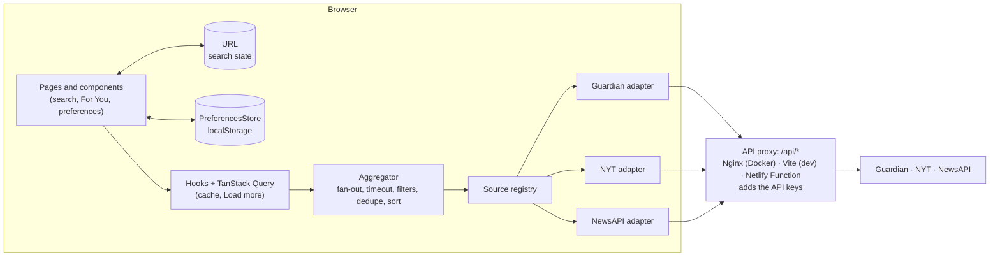

# NewsLens

[](https://github.com/hamdi-karim/NewsLens/actions/workflows/ci.yml)

One clean, fast, personalized feed of articles from **The Guardian**, **The New York Times**, and **NewsAPI.org**.

**Live demo:** https://newslens-app.netlify.app

Built with Vite, React 19, strict TypeScript, TanStack Query, React Router, Tailwind v4, and shadcn/ui. Tested with Vitest, React Testing Library, and MSW. Served by Nginx in Docker, or on Netlify with a serverless proxy.

## Features

- **Search** by keyword across all three sources at once, debounced, with results merged into one list
- **Filters** by date (presets or a custom range), category, and source. Filters combine with the keyword and live in the URL, so a search can be shared and Back works.
- **For You**: a personalized feed from your preferred sources and categories. Articles by authors you follow are boosted to the top.
- **Partial failures**: if one source fails or is rate-limited, the others still show, with a notice explaining what's missing
- **Load more**: pagination that only calls the sources that still have results
- **Responsive and accessible**: a mobile filter sheet, skip link, keyboard support, labelled controls, and WCAG AA contrast in light and dark themes

## Quick start (Docker)

You need **Docker** and three free API keys:

| Source         | Get a key                                                                   | Variable           |
| -------------- | --------------------------------------------------------------------------- | ------------------ |
| The Guardian   | https://open-platform.theguardian.com/access/                               | `GUARDIAN_API_KEY` |
| New York Times | https://developer.nytimes.com/get-started (enable the _Article Search API_) | `NYT_API_KEY`      |
| NewsAPI.org    | https://newsapi.org/register                                                | `NEWSAPI_API_KEY`  |

```bash
git clone https://github.com/hamdi-karim/NewsLens.git
cd NewsLens
cp .env.example .env      # then fill in the three keys
docker compose up --build
```

Open http://localhost:8080.

API keys are injected into the Nginx proxy **when the container starts**. They are never part of the JavaScript bundle or the image.

## Run locally

Requires **Node.js 22.12+**.

```bash
cp .env.example .env      # then fill in the three keys
npm install
npm run dev
```

Open http://localhost:5173. The Vite dev server proxies `/api/*` exactly like Nginx does in Docker.

### Mock mode (no API keys, no quota)

```bash
npm run dev:mock
```

`/api/*` is answered in the browser by [MSW](https://mswjs.io) with the same fixtures the tests use (trimmed real responses in `src/test/fixtures/`), so UI work doesn't spend the free-tier quotas. Mock mode only exists in the dev server; production builds contain no mock code.

### Scripts

| Script               | Purpose                                             |
| -------------------- | --------------------------------------------------- |
| `npm run dev`        | Vite dev server with API proxy                      |
| `npm run dev:mock`   | Dev server with `/api/*` served from MSW fixtures   |
| `npm run build`      | Type check + production build                       |
| `npm run preview`    | Preview the production build locally (no API proxy) |
| `npm run lint`       | ESLint                                              |
| `npm run typecheck`  | TypeScript (`tsc -b`)                               |
| `npm run test`       | Vitest (run once)                                   |
| `npm run test:watch` | Vitest watch mode                                   |
| `npm run format`     | Prettier                                            |

### Rate limits

The free tiers are tight, so responses are cached for 5 minutes and searches are debounced:

| Source         | Free-tier limit (approx.)               |
| -------------- | --------------------------------------- |
| The Guardian   | ~1 request/second, ~500/day             |
| New York Times | 5 requests/minute, 500/day              |
| NewsAPI.org    | ~100 requests/day, development use only |

NewsAPI's free plan only covers about the last month, so a search starting earlier skips NewsAPI (without spending a request) and shows results from the other sources.

## Deploy (Netlify)

The repo deploys to Netlify as-is ([`netlify.toml`](netlify.toml)): Netlify builds the app and serves `dist/`, and a [Netlify Function](netlify/functions/api.ts) takes over Nginx's job for `/api/*`, with the same allowlist and the keys added server-side.

1. In Netlify, **Add new site → Import an existing project** and pick this repository. Build settings come from `netlify.toml`.
2. In **Site configuration → Environment variables**, add `GUARDIAN_API_KEY`, `NYT_API_KEY`, and `NEWSAPI_API_KEY`.
3. Deploy. Every push to `main` redeploys.

The browser still only calls same-origin `/api/*`, so the keys never reach the bundle. Docker stays the way to run it yourself.

## Architecture



A request flows one way:

1. A page turns the URL (or saved preferences) into an `ArticleQuery`.
2. A TanStack Query hook caches the result by that query.
3. The aggregator asks every selected source in parallel.
4. Each adapter translates the query into its provider's parameters and maps the response into one shared `Article` model.
5. The browser only ever calls `/api/*` on its own origin. The proxy adds the key and forwards the request to an allowlisted provider endpoint.

| Folder          | Responsibility                                                                     |
| --------------- | ---------------------------------------------------------------------------------- |
| `src/app/`      | Routes, layout, providers, query client                                            |
| `src/domain/`   | Shared types (`Article`, `ArticleQuery`, `NewsSource`, `PreferencesStore`), errors |
| `src/sources/`  | One folder per provider (adapter, mapper, category map) plus the registry          |
| `src/services/` | Aggregator and author matching: plain functions, no React                          |
| `src/features/` | Feature folders: `search`, `feed`, `articles`, `preferences`, `theme`              |
| `src/shared/`   | UI primitives (shadcn), hooks, http client, helpers                                |
| `src/test/`     | MSW handlers, fixtures, render helpers                                             |
| `docker/`       | Nginx config template (proxy allowlist, key injection)                             |

Adding a source means adding a new folder in `src/sources/` that implements `NewsSource`, plus one line in the registry. The aggregator never branches on which source it's talking to.

## Why three sources

The suggested list also included OpenNews, NewsCred, and BBC News. OpenNews and NewsCred are no longer publicly available, and the BBC has no public news API. The three used here are all live, documented, and free to try. Each one forced a different design decision:

- **The Guardian**: strong search and sections
- **NYT**: a strict rate limit, so caching and debounce are mandatory
- **NewsAPI**: blocks browser calls outside localhost, so a proxy is needed. It also has two endpoints with different filters.

## Key decisions

| Decision                                                                                     | Alternative rejected                   | Why                                                                                                                                                                                                                         |
| -------------------------------------------------------------------------------------------- | -------------------------------------- | --------------------------------------------------------------------------------------------------------------------------------------------------------------------------------------------------------------------------- |
| **Nginx proxy** for `/api/*` ([config](docker/nginx/default.conf.template))                  | A small Express backend                | Solves CORS, NewsAPI's localhost restriction, and keeping keys out of the bundle, with config instead of code. An allowlist means the keys can only reach the endpoints the app uses.                                       |
| **Netlify Function** as the hosted proxy ([function](netlify/functions/api.ts))              | GitHub Pages; Netlify redirect rules   | Pages is static only, so the keys would ship in the bundle. Redirect rules can't read environment variables, so the key would be committed in `netlify.toml`. The function is the Nginx allowlist in code, with unit tests. |
| **`Promise.allSettled` + 8 s timeout per source** ([aggregator](src/services/aggregator.ts)) | `Promise.all`                          | One failing source can't discard the others. The timeout stops one slow source from holding the page.                                                                                                                       |
| **URL as the source of truth** for search state                                              | A global store                         | Shareable links and Back/Forward for free, with no state to sync                                                                                                                                                            |
| **TanStack Query** for server state, no global state library                                 | Redux, Zustand                         | The only shared client state is preferences and theme. Both are small stores read with `useSyncExternalStore`.                                                                                                              |
| **`PreferencesStore` interface** over `localStorage`                                         | Calling `localStorage` from components | Validated and versioned, injected through context (tests use an in-memory store). Server-side accounts would mean a new implementation, not a rewrite.                                                                      |
| **Capability-driven filtering**                                                              | Per-source `if`s in the aggregator     | Each adapter declares which filters its API supports server-side. The aggregator applies the rest client-side.                                                                                                              |
| **Authors boost, they don't filter**                                                         | Filtering the feed by followed authors | No provider has reliable author search. Filtering would often leave an empty feed. Matching bylines after the merge costs no extra request.                                                                                 |
| **Dedupe by normalized URL**, registry order wins                                            | Fuzzy title matching                   | NewsAPI re-publishes Guardian/NYT stories. A URL match is predictable and needs no source-specific code.                                                                                                                    |
| **"Load more"** with per-source pages                                                        | Infinite scroll; merged cursors        | Simple, accessible, and only calls sources that still have results. The full list is re-sorted after each page.                                                                                                             |
| **Route splitting only where it pays** (`/search` is lazy)                                   | Lazy-loading every route               | Measured: the other routes share most of their code, so splitting them deferred almost nothing                                                                                                                              |

## Testing

Tests exercise the **real** adapters → mappers → aggregator path. [MSW](https://mswjs.io) intercepts `fetch` at the network edge and answers with fixtures trimmed from real API responses. This means:

- no real API calls, keys, or rate limits in tests (any unhandled request fails the test)
- failure paths (429, 500, timeouts) are simulated per source to test partial results
- the same handlers power `npm run dev:mock`

| Level       | What                                                                                                                                                                                             |
| ----------- | ------------------------------------------------------------------------------------------------------------------------------------------------------------------------------------------------ |
| Unit        | Mappers, category maps, URL ↔ query parsing, aggregator, preferences validation, theme store                                                                                                     |
| Integration | Pages rendered through the real providers and routes: search states, filters, the For You feed, the preferences form, sheets                                                                     |
| Journey     | [`searchJourney.test.tsx`](src/app/searchJourney.test.tsx): header search → `/search?q=` → category and source filters → only the selected sources are requested → Back is served from the cache |

Components are queried by role and label, not by class or test id, so the tests also check accessibility.

## CI

[GitHub Actions](.github/workflows/ci.yml) runs on every push to `main` and every pull request: `npm ci`, lint, type check, test, build. These are the same checks that define "done" locally. The workflow needs no secrets, which also proves the build doesn't depend on the API keys.

## Trade-offs and known limitations

- **The live demo uses NewsAPI's free Developer plan,** which is meant for development and allows ~100 requests a day. When the quota runs out, NewsAPI shows as unavailable and the other two sources keep working.
- **The proxy allowlist exists three times:** Nginx (Docker), the Vite dev proxy, and the Netlify Function. Each runs in a different runtime, so each keeps a small copy. The function's copy is unit-tested.
- **Author search is weak.** No provider offers reliable author search, so authors are a boost based on byline matching, not a filter.
- **Ordering can shift on "Load more".** New pages are merged and the list is re-sorted, so an article can move. That's the cost of a single sorted list across sources with separate pagination.
- **NewsAPI only covers about the last 30 days** on the free plan. Older date ranges skip it, and the page says so.
- **NewsAPI's `/top-headlines` has no date filter, and `/everything` has no category filter.** The adapter picks the endpoint per query, and the aggregator filters the rest client-side.
- **Dev-only duplicate requests.** React StrictMode mounts twice in development, and query cancellation can repeat a request. Production builds aren't affected.

## Next steps

- User accounts and server-side preferences (a new `PreferencesStore` implementation)
- Backend aggregation with a shared cache, to spend less of each API's quota
- SSR / SEO
- Internationalization
- End-to-end tests in a real browser (Playwright)
- More sources through the adapter pattern
